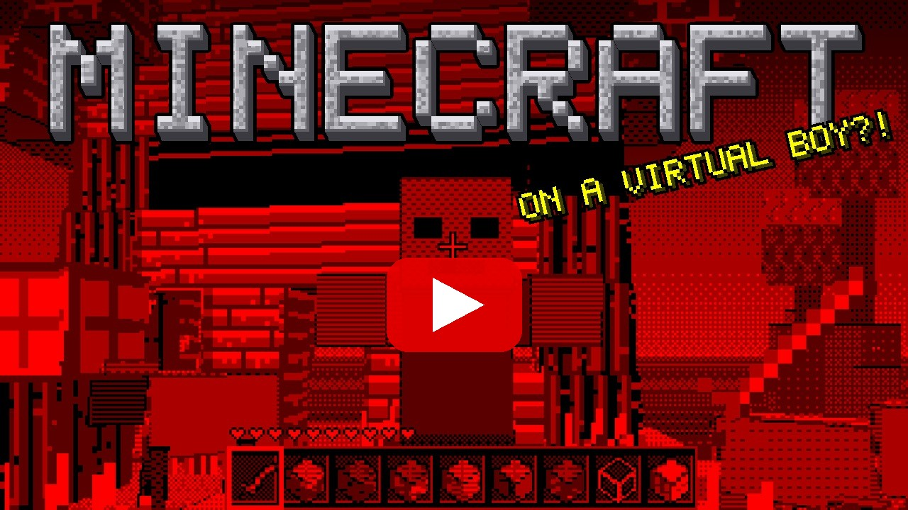
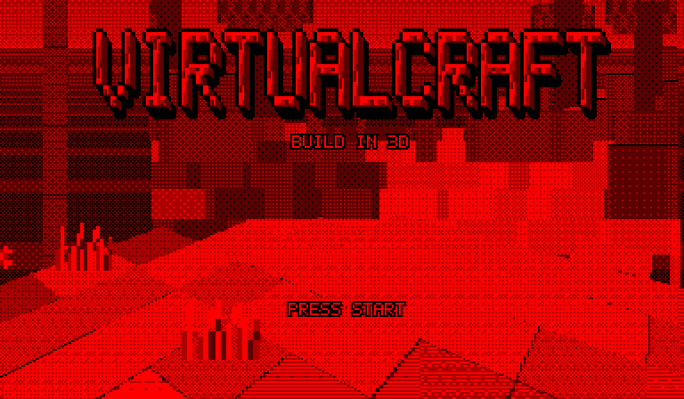
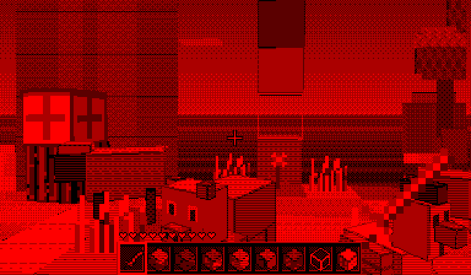
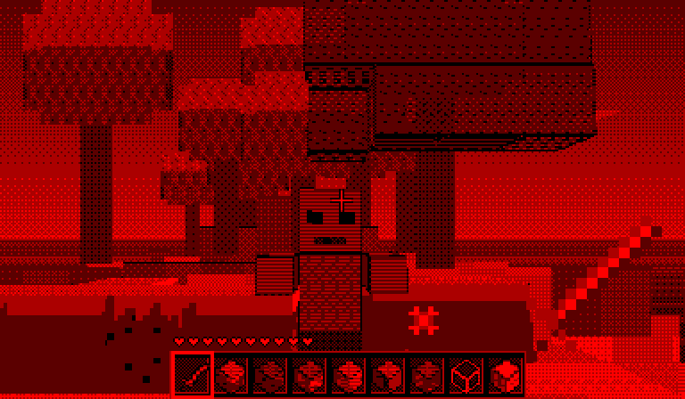
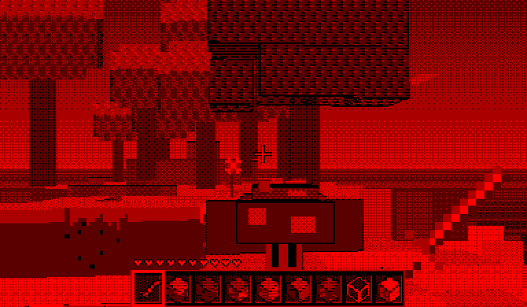

# Virtualcraft

A block-building game for the **Virtual Boy**: a small island in an endless sea, drawn live in stereo 3D by the console's
20 MHz CPU. Break and place blocks, build whatever you like, meet pigs, sheep and chickens, and fight zombies and boomcaps
with your sword.

  

  
  
  

| | | |
|---|---|---|
|  |  |  |

## Download

Get **`virtualcraft.vb`** (2 MB) from the [Releases](../../releases) page.

SHA-1: `a4de2d6df76eedb4c1a32c9b32966abdd51a1865`

## Playing it

- **In your browser:** [supermochi64.itch.io/virtualcraft](https://supermochi64.itch.io/virtualcraft), no install needed.
  Keyboard: WASD walk, arrow keys look, Space jump, J break, K place, Q/E pick a block, Enter pause.
  Gamepads and phone touch controls work too.
- **Emulators:** any Virtual Boy emulator that runs commercial games, e.g. Mednafen or RetroArch with the Beetle VB core.
- **Flash carts:** the ROM is 2 MB, so it fits 2 MB flash carts.

## Controls

| Button | Action |
|---|---|
| Left D-pad | walk |
| Right D-pad | look around |
| A | jump / swim |
| L trigger | break blocks (hold), attack with the sword |
| R trigger | place the selected block |
| B / Select | next / previous block in the hotbar |
| Start | pause (shows the controls) |

## Features

- A 64 x 64 island with meadows, forests, a stone mountain, dunes, a lake, islets and a cabin by a pond
- Live 3D rendering into the Virtual Boy's frame buffers: textured blocks near you, a height-field far view out to the
  horizon, both eyes drawn every picture (true stereo depth)
- Break and place 8 kinds of blocks (grass, dirt, cobblestone, planks, logs, bricks, glass, lamps); gold ore to find
- Pigs, sheep and chickens; zombies that chase you; boomcaps that sneak up, hiss and blow holes in the ground
- A sword, hearts, knock-back, respawning at the cabin
- Original music, chimney smoke, butterflies, waves on the sea

## Building from source

Needs `v810-gcc` (GCC 4.9.4 for the NEC V810). Then:

    V810=/path/to/v810-gcc/bin ./build.sh      # -> build/virtualcraft.vb

The generated data (font, sounds, pre-scaled textures, tables) is included in `gen/`. To make it again:
`python3 tools/textures.py` (numpy) and `python3 tools/assets.py` (numpy, ffmpeg, and
[minetest_game](https://github.com/minetest/minetest_game) cloned into `ext/mtg` for the block sounds).

## Credits and license

See [CREDITS.md](CREDITS.md). Code, textures, font and music: original work, MIT license ([LICENSE](LICENSE)).
The block sounds come from Minetest Game under CC BY-SA 3.0 / CC BY 3.0 / CC0 1.0 and keep those licenses.

Virtualcraft is a fan-made homebrew game, not affiliated with or endorsed by Nintendo or Mojang.
"Virtual Boy" is a trademark of Nintendo.
