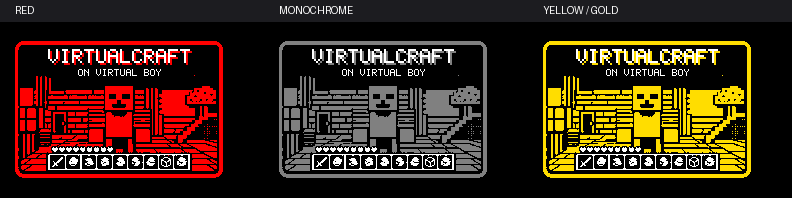

# Virtualcraft HyperFlash32 labels

For `virtualcraft.vb`, copy the matching label to the SD card’s `LABEL` folder. If you renamed the ROM, use the same name for the label while keeping its extension.

| Display | File |
| --- | --- |
| Black, white and red | [`virtualcraft.bwr`](virtualcraft.bwr) |
| Monochrome | [`virtualcraft.label`](virtualcraft.label) |
| Black, white and yellow | [`virtualcraft-bwy.bmp`](virtualcraft-bwy.bmp) for import with your cart’s HyperFlasher setup |

The two preconverted files are 264 × 176 pixels and were checked by decoding them back to the label image. The yellow BMP is source artwork for conversion. Physical display testing is welcome.
